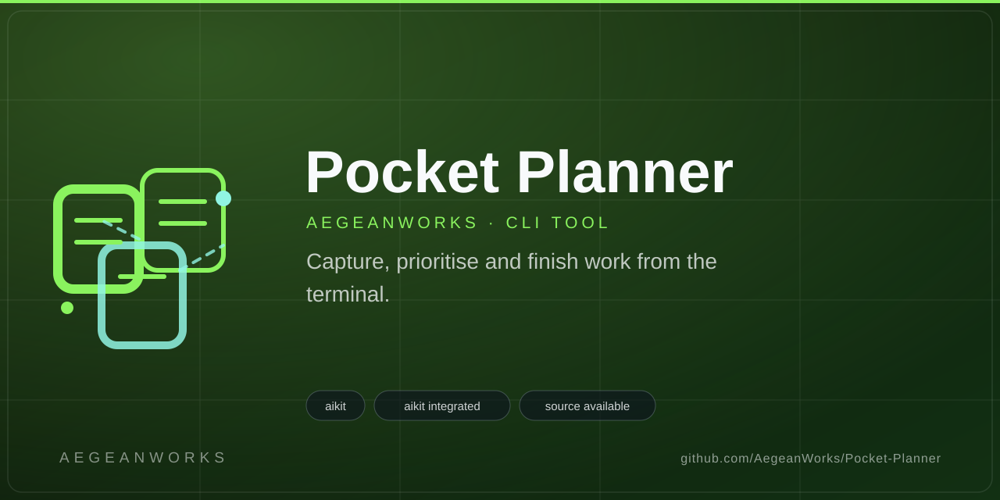

# Pocket Planner

<!-- aegean:media:start -->
<p align="center"></p>
<p align="center"><a href="LICENSE"></a> <a href="https://github.com/AegeanWorks/AIKit"></a></p>
<!-- aegean:media:end -->


A local-first task manager for capturing, prioritizing, and completing work from a fast terminal workflow.

## ⚡ 30-Second Cold-Start Quick Reference

- **Runtime Prerequisites**: Python 3.10+; standard library only.
- **Canonical Regression Shield Gate**:
  ```bash
  python -m unittest discover -s tests -p "test_*.py"
  ```

### Usage

Run these commands from this directory:

```bash
python pocket_planner.py add "Write project brief" --priority 1
python pocket_planner.py add "Review pull request" --priority 2 --due today+3 --tag work --tag review
python pocket_planner.py list
python pocket_planner.py list --tag work
python pocket_planner.py list --overdue
python pocket_planner.py list --priority 1
python pocket_planner.py done 1
python pocket_planner.py reopen 1
python pocket_planner.py edit 1 --title "New title" --priority 1 --due 2026-12-01 --tag work
python pocket_planner.py rm 1
python pocket_planner.py list --all
python pocket_planner.py list --search review --sort priority
python pocket_planner.py next
python pocket_planner.py stats
python pocket_planner.py stats --json
python pocket_planner.py list --json
python pocket_planner.py list --limit 5
python pocket_planner.py export backup.json
python pocket_planner.py import backup.json
```

`rm` also accepts the alias `delete`: `python pocket_planner.py delete 1`.

`edit` updates title, priority, due date, or tags in place. Pass `--clear-due` to remove the due date or `--clear-tags` to remove all tags. `--tag` may be repeated and replaces the tag set.

`list` accepts `--search text` (case-insensitive substring match over titles and tags), `--sort {due,priority,id,created}`, `--limit N` (the first N after sorting), and `--json` (one JSON line with the full task records through the same filters); the default order is due, then priority, then id. `export path` writes a full copy of the store (including completed tasks) to another file; `--format {store,json-tasks,markdown}` picks the shape: `store` (default) is a re-importable full copy that keeps unknown forward-compat task fields, root-level keys, and the id fence so a retired id is never reissued; `json-tasks` writes only the task records as a bare JSON array (unknown fields included); `markdown` writes a human-editable checklist and is one-way (not importable). `import path` validates the source through the normal load path and **replaces** the store content with it atomically — a missing source fails without the `.bak` fallback. The source may be a full store root or a bare JSON task array, and unknown fields and `next_id` are carried across. `import path --merge` adds the incoming tasks to the current store instead of replacing it; ids that collide with existing tasks are renumbered into free ids, and unknown task fields travel with their tasks. The global `--wait SECONDS` option caps how long mutating commands wait for the store lock (default 3; `--wait 0` fails immediately when contended). `next` prints the top open task in that same default order and fails cleanly when nothing is open. `stats` prints open/done/overdue counts and the priority distribution; `stats --json` emits the same summary as a single JSON line (with `by_priority` as string keys) for scripts and agents.

Tasks are stored in `.pocket-planner.json` in the current directory. Use `--file path/to/tasks.json` to select another store. Tasks support priorities, ISO due dates in `YYYY-MM-DD` format (a compact `YYYYMMDD` value is accepted and canonicalized, and relative forms — `today`, `today+N`, `today-N`, case-insensitive — are frozen to their absolute date at insert time; `add` and `edit` accept them, stored data stays absolute), and repeatable tags. The store root carries a `schema_version` key; stores written by a newer client fail load with an error naming the version instead of being misread. Writes use a temporary file, `fsync`, and atomic replacement; each write also rotates two backup generations beside it — `.bak` holds the previous store and `.bak.1` the one before — which is read back if the main file is missing after a crash, so an interrupted write never leaves a partial database. Mutating commands (`add`, `done`, `reopen`, `rm`/`delete`, `edit`) serialize through an advisory lock file beside the store: a simultaneous second process waits up to 3 seconds and then fails with `Error: store is locked by another process` (exit 1) instead of overwriting the first writer, and a lock left behind by a killed process is ignored after 30 seconds. Read-only commands (`list`, `stats`, `next`) never block.

### 🛠️ AIKit Commands (run from the AIKit folder)
| Role | Command |
|---|---|
| Status, task and gates | `python aikit.py status pocket-planner` |
| Phase 4: every gate | `python aikit.py check pocket-planner` |
| Repair memory and map, then check | `python aikit.py fix pocket-planner` |
| Resume an interrupted task | `python aikit.py resume pocket-planner` |

## 📦 What's Inside

```text
pocket-planner/
├── .gitignore                <- transient AIKit state excluded
├── LICENSE                   <- Aegean License 1.1 (AL-1.1): free personal use
├── COMMERCIAL.md             <- Commercial licensing terms
├── LICENSES/                 <- REUSE license texts
├── REUSE.toml                <- Machine-readable SPDX metadata
├── README.md
├── assets/                   <- project logo and social preview
│   ├── logo.svg
│   └── social-preview.svg
├── pocket_planner.py         <- task store and CLI
├── tests/
│   ├── test_pocket_planner.py
│   └── test_pocket_planner_pure.py
└── .aikit/                   <- this project's memory: record, ledger, decisions
```

<!-- aegean:brand-assets:start -->
## 🎨 Brand Assets

> **AI-Generated Brand Artwork.** The banner and logo are **AI-generated brand assets**. They are illustrative and may not literally depict every feature or the full project scope.
<!-- aegean:brand-assets:end -->

## 📜 License

Free for personal use under the Aegean License 1.1 (AL-1.1); see [LICENSE](LICENSE). Any commercial use needs the Aegean Commercial License 1.0 (ACL-1.0); see [COMMERCIAL.md](COMMERCIAL.md).
